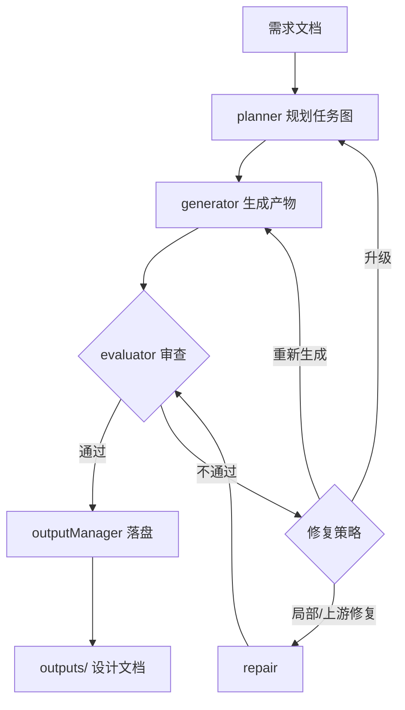

# ReqDesign-Agent

> 多智能体 LLM 系统：把一份自然语言需求文档，自动转成结构化的需求分析、系统设计、Mermaid 图表与测试用例。

---

## 1. 项目简介

ReqDesign-Agent 是一个**需求驱动的软件设计自动化助手**（package.json 描述原文："Multi-agent LLM system for requirements-driven software design"）。

**它解决什么问题**：从一份中文/英文需求文档出发，自动完成"需求分析 → 领域建模 → 系统设计 → 图表生成 → 测试用例 → 质量审查"整条流水线，并在质量未达标时自动修复，最终交付一套可追溯的设计文档。

**目标用户**：
- 需要快速把模糊需求落地为设计文档的开发者 / 架构师
- 需求工程、软件设计课程的教学与练习场景
- 想研究"单 Agent + 多工具"LLM 编排范式的工程师

---

## 2. 核心特性

- **一站式需求到设计**：输入一份需求文档，输出需求分析、领域模型、系统设计、三类 Mermaid 图（类图/活动图/状态图）、测试用例与质量审查报告。
- **单 Agent + 多工具编排**：一个 `AgentOrchestrator` 统一调度 4 个 worker（planner / generator / evaluator / repair），用确定性策略优先、LLM 策略兜底，兼顾稳定与灵活。
- **自动修复循环**：evaluator 发现问题后，编排器自动选择"局部修复 / 上游修复 / 重新生成 / 重新规划"，无需人工干预即可收敛。
- **多 Provider 支持**：内置 7 个 provider（openai / anthropic / deepseek / qwen / minimax / kimi-coding / zhipu），统一走 OpenAI 兼容或 Anthropic 协议。
- **可追溯产物**：每个产物都带 `traces/` 下的 LLM 调用、多智能体决策、追溯矩阵，方便审计与复现。
- **内置 Benchmark v2**：基于 gold contract 的证据式评测，能量化设计质量（覆盖度 / 追溯真实性 / 测试有效性 / 设计深度）。

---

## 3. 工作原理

ReqDesign-Agent 把"需求 → 设计文档"建模为一条**多阶段流水线 + 修复循环**：

1. **输入**需求文档（`.md` / `.txt` / `.json` / `.xml`）。
2. **planner** 拆解任务图（analyze → domain_model → design → diagrams → tests）。
3. **generator** 按依赖关系并发执行各任务，产出 artifact。
4. **evaluator** 依据项目宪法（`ReqDesign.md`）审查质量。
5. 若有问题，**repair** 按反馈修复；修复不收敛则升级到重新规划。
6. 全部通过质量门槛后，**outputManager** 落盘 7 类产物。



> 控制链路细节见 [docs/ARCHITECTURE.md](docs/ARCHITECTURE.md)。

---

## 4. 环境要求

| 项 | 要求 |
|----|------|
| Node.js | **≥ 18.0.0**（见 `package.json` 的 `engines.node`） |
| 操作系统 | 跨平台（Windows / macOS / Linux） |
| LLM API | 至少一个 provider 的有效 API Key（见第 5 节） |

---

## 5. 快速开始

### 5.1 安装依赖

```bash
npm install
```

### 5.2 配置 .env

在项目根目录创建 `.env`，按你要用的 provider 填入对应的 Key（**只列键名，不在此写值**）：

```bash
# 7 个 provider 各自的环境变量键名（任选其一即可）
OPENAI_API_KEY=
DEEPSEEK_API_KEY=
QWEN_API_KEY=
MINIMAX_API_KEY=
KIMI_API_KEY=
ZHIPU_API_KEY=
# Anthropic 走专用 token 名
ANTHROPIC_AUTH_TOKEN=
# 通用兜底（任何 provider 缺 key 时都会尝试它）
REQDESIGN_API_KEY=
```

> 默认配置（`config.yaml`）使用 `provider: qwen`，所以最快的方式是填 `QWEN_API_KEY=`。

### 5.3 构建

```bash
npm run build
```

构建做两件事（见 `package.json` 的 `build` 脚本与 `scripts/copy-assets.mjs`）：
1. `tsc` 编译 `src/` → `dist/`
2. `node scripts/copy-assets.mjs` 把 `prompts/` 复制到 `dist/prompts/`

### 5.4 跑通第一个需求

项目自带示例需求（`examples/`），用一个最简单的计算器需求验证：

```bash
# 用 dev 脚本直接跑（tsx 免编译）
npm run dev -- -i examples/test_requirements.md

# 或用构建产物跑
node dist/src/main.js -i examples/test_requirements.md
```

跑完后在 `outputs/` 下会生成一个 run 目录，包含 `requirement/`、`design/`、`diagrams/`、`tests/`、`review/` 等子目录（产物结构见第 8 节）。

可复制的真实示例文件（`examples/`）：

| 文件 | 适合场景 |
|------|----------|
| `examples/test_requirements.md` | 简单计算器，最快验证流水线是否通 |
| `examples/mid_complex_system.md` | 中等复杂度（在线图书管理） |
| `examples/ecommerce_order_system.md` | B2C 电商订单 |
| `examples/hospital_mgmt.md` | 三甲医院门诊 |
| `examples/smart_campus.md` | 智慧校园 |
| `examples/XMLZIPFile/` | XML 格式需求输入示例 |

---

## 6. CLI 完整用法

CLI 入口为 `bin: reqdesign -> dist/src/main.js`（见 `package.json`），源码在 `src/main.ts`。

### 6.1 设计模式（默认 / 主要用法）

```bash
reqdesign -i <需求文档> [选项]
```

| 选项 | 默认 | 说明 |
|------|------|------|
| `-i, --input <path>` | （必填） | 输入需求文档路径，支持 `.md` / `.txt` / `.json` / `.xml` |
| `-o, --output <path>` | `outputs/`（取自 `config.output.defaultDir`） | 输出目录 |
| `-c, --config <path>` | `config.yaml` | 配置文件路径 |
| `-m, --model <model>` | 取自配置 | 覆盖配置中的 model |
| `-p, --provider <provider>` | 取自配置 | 覆盖配置中的 provider（必须是 7 个合法值之一） |
| `--goal <goal>` | `design` | 任务目标；公开 CLI 只支持 `design`，`analyze` 是内部阶段 |
| `--log-level <level>` | `INFO` | 日志级别：`DEBUG`/`INFO`/`WARNING`/`ERROR`/`CRITICAL` |

> 启动时会校验配置，缺失 API Key 会直接报错退出（见 `src/main.ts` 的 `loadConfig`）。

### 6.2 chat 子命令（终端交互式 UI）

```bash
reqdesign chat [-c <config>] [-m <model>] [-p <provider>] [--log-level <level>]
# 或用 npm 脚本
npm run chat
```

启动全屏终端聊天 UI（`src/tui/chatApp.ts`）。

### 6.3 benchmark 子命令（评测）

加上 `--benchmark` 即进入 Benchmark v2 评测模式（详见 `benchmark/README.md`）：

```bash
reqdesign --benchmark -i benchmark/cases [benchmark 选项]
```

| 选项 | 默认 | 说明 |
|------|------|------|
| `--benchmark` | `false` | 运行 benchmark 评测 |
| `--mode <mode>` | `dev` | 模式：`dev`（开发）或 `eval`（评测，每 case 跑 N 次） |
| `--n <count>` | `1` | eval 模式下每个 case 的运行次数（正整数） |
| `--resume` | `false` | 续跑一个已存在的 benchmark run |
| `--gold-dir <path>` | `benchmark/gold_contracts` | gold contract 目录 |
| `--case <id>` | （无） | 只跑指定 case id |
| `--only-failed` | `false` | 续跑时只跑上次失败的 case |
| `--label <label>` | （无） | 给 benchmark id 追加标签 |
| `--benchmark-id <id>` | （无） | 要续跑的 benchmark id，或 `latest` |

示例：

```bash
# eval 模式，每个 case 跑 3 次
node dist/src/main.js --benchmark --mode eval --n 3 -i benchmark/cases -o benchmark/results

# 只跑一个 case
node dist/src/main.js --benchmark --case hospital_mgmt -i benchmark/cases

# 续跑最近一次
node dist/src/main.js --benchmark --resume --benchmark-id latest -i benchmark/cases
```

---

## 7. 配置参考

### 7.1 config.yaml 字段

配置文件用 Zod schema 严格校验（见 `src/config.ts`）。顶层分 6 块：

| 区块 | 字段（camelCase，YAML 中也可写 snake_case） | 含义 |
|------|------|------|
| `llm` | `provider` | 7 选 1：`openai`/`anthropic`/`deepseek`/`qwen`/`minimax`/`kimi-coding`/`zhipu` |
| | `model` | 模型名，如 `qwen3.5-flash` |
| | `api_key` | 留空时走 .env（默认留空） |
| | `base_url` | 自定义网关地址（如本仓库默认指向阿里云 MaaS） |
| | `temperature` | 0~2，默认 0.3 |
| | `max_tokens` | 单次输出上限，默认 8192（本项目配置 65536） |
| | `timeout` | 单次 HTTP 请求超时秒数，默认 120（本项目配置 600） |
| `retry` | `max_retries` / `retry_delay_ms` / `max_delay_ms` / `retry_on_timeout` | 重试策略 |
| `output` | `default_dir` | 默认输出目录，`outputs/` |
| | `trace.*` | 各类 trace 开关（run_summary / llm_trace / multi_agent_trace / traceability_matrix / multi_agent_trace_full_dump） |
| `logging` | `level` / `log_dir` | 日志级别与目录 |
| `orchestration` | `max_concurrency` | worker 最大并发（本项目配置 5） |
| | `max_runtime_seconds` | 单次 run 整体 wall-clock 上限秒数（本项目配置 3600） |
| | `worker_timeout_seconds` | 单个 worker 会话超时（本项目配置 2400） |
| | `skip_evaluation` | 是否跳过评审 |
| | `convergence_accept_max_issues_*` | 收敛卡死时的强制接受阈值 |
| `benchmark` | `entity_name_map` / `function_synonyms` | 评测用的实体名/功能同义词归一 |

### 7.2 .env 环境变量

| 键名 | 用途 |
|------|------|
| `OPENAI_API_KEY` | provider=openai 时使用 |
| `DEEPSEEK_API_KEY` | provider=deepseek 时使用 |
| `QWEN_API_KEY` | provider=qwen 时使用（本项目默认） |
| `MINIMAX_API_KEY` | provider=minimax 时使用 |
| `KIMI_API_KEY` | provider=kimi-coding 时使用 |
| `ZHIPU_API_KEY` | provider=zhipu 时使用 |
| `ANTHROPIC_AUTH_TOKEN` | provider=anthropic 时使用（注意是 `_AUTH_TOKEN`） |
| `REQDESIGN_API_KEY` | 通用兜底：任何 provider 缺 key 时都会尝试它 |
| `OPENAI_BASE_URL` / `DEEPSEEK_BASE_URL` / `QWEN_BASE_URL` / `MINIMAX_BASE_URL` | 各 provider 自定义 base URL |
| `ANTHROPIC_BASE_URL` | Anthropic 自定义 base URL |
| `REQDESIGN_PROMPT_DIR` | 自定义 prompt 目录（见 `src/promptLoader.ts`） |

> 解析逻辑见 `src/config.ts` 的 `getApiKey()` / `getBaseUrl()`。

---

## 8. 输入与输出

### 8.1 需求文档格式

支持扩展名（见 `src/inputLoader.ts` 的 `SUPPORTED_EXTENSIONS`）：`.md` / `.txt` / `.json` / `.xml`。

- Markdown / 纯文本：直接写需求，参考 `examples/test_requirements.md`（含用户角色、功能需求、业务约束、异常流程）。
- XML：会额外构建章节索引与 spanMap（见 `src/xmlParser.ts`），适合结构化需求（如 `examples/XMLZIPFile/`）。
- 限制：单文件 ≤ 512KB、≤ 100,000 字符（见 `src/inputLoader.ts`）。

### 8.2 outputs/ 产物结构

每次 run 在输出目录下生成以下结构（由 `src/outputManager.ts` 管理，子目录常量定义于 `src/outputManager.ts:34-40`）：

```
outputs/<run>/
├── requirement/      需求分析：analysis.json + analysis.md
├── domain_model/     领域概念模型：domain_model.json
├── design/           系统设计：system_design.md
├── diagrams/         Mermaid 图表：class_diagram.mmd / activity_diagram.mmd / state_diagram.mmd + diagrams.json
├── tests/            测试用例：test_cases.json + test_cases.md
├── review/           审查报告：report.md + result.json
├── traces/           执行追踪：run_summary.json / llm_trace.json / multi_agent_trace.json / traceability_matrix.json
├── by_task/<taskId>/ 按任务分放的原始产物（便于审计）
└── summary_report.md 汇总报告（含需求统计、审查结果、已知局限）
```

| 子目录 | 放什么 |
|--------|--------|
| `requirement/` | 结构化需求分析（actors / functions / entities / constraints / exceptions / NFR / 业务流程） |
| `domain_model/` | 领域概念模型（实体、枚举、泛化、关联） |
| `design/` | 模块划分、核心类、接口、数据流、技术选型 |
| `diagrams/` | 三类 Mermaid 图（类图 / 活动图 / 状态图） |
| `tests/` | 正常 / 异常 / 边界测试用例 |
| `review/` | 终审报告与各维度评分、问题清单 |
| `traces/` | LLM 调用、多智能体决策、追溯矩阵等可追溯证据 |

> 引用某个具体 run 前，请先确认其 `traces/run_summary.json` 中 `run_status=completed`，不要直接假定某固定 run 目录名。

---

## 9. 项目结构

```
ReqDesign-Agent/
├── src/                  TypeScript 源码（主程序）
│   ├── main.ts           CLI 入口（commander，定义 run/chat/benchmark）
│   ├── config.ts         配置加载与校验（Zod schema、.env、provider 解析）
│   ├── runtime.ts        运行时主循环：编排器 → 派发 worker → 处理结果 → 落盘
│   ├── state.ts          工作流状态
│   ├── constitution.ts   加载项目宪法 ReqDesign.md 作为顶层约束
│   ├── inputLoader.ts    需求文档加载（md/txt/json/xml）
│   ├── outputManager.ts  7 子目录产物管理
│   ├── llmClient.ts      统一 LLM 客户端（OpenAI 兼容 + Anthropic）
│   ├── promptLoader.ts   prompts/ 模板加载（带缓存）
│   ├── orchestration/    编排核心：orchestrator / policy / strategy / strategyBrain / budget / snapshot
│   ├── execution/        worker 工厂与会话后端（factory.ts / backend.ts）
│   ├── tools/            4 个 worker：planning / generation / evaluation / repair
│   ├── generators/       具体生成器（analyze / domainModel / design / diagrams / tests / merge ...）
│   ├── runtime/          运行时子服务（事件桥、持久化、派发、结果处理）
│   ├── tui/              终端交互式聊天 UI
│   ├── memory/           编排器记忆
│   ├── shared/           共享类型、文档归一化、追溯等
│   ├── benchmark/        Benchmark v2 runner / judge / resultStore
│   └── utils/
├── prompts/              17 个提示词模板（.md），strategy_brain.md 为英文，其余中文
├── tests/                78 个 vitest 测试文件
├── examples/             示例需求文档（5 个 .md + XMLZIPFile/）
├── benchmark/            评测数据集与工具（cases / gold_contracts / mutants / README.md）
├── docs/                 架构与规格文档（见第 11 节）
├── vscode-extension/     VS Code 扩展子项目
├── config.yaml           默认配置
├── ReqDesign.md          项目宪法（质量标准，6 章）
├── tsconfig.json         ES2022 / NodeNext / strict
├── vitest.config.ts      测试配置
├── eslint.config.js      lint 配置
└── package.json
```

---

## 10. 开发指南

| 命令 | 作用 |
|------|------|
| `npm run build` | `tsc` 编译 + `node scripts/copy-assets.mjs` 复制 prompts 到 dist |
| `npm run dev` | `tsx src/main.ts`，免编译直接跑设计模式 |
| `npm run chat` | `tsx src/main.ts chat`，免编译直接跑交互式 UI |
| `npm test` | `vitest run`，跑全部 78 个测试文件 |
| `npm run test:watch` | `vitest`，watch 模式 |
| `npm run lint` | `eslint src/` |
| `npm run typecheck` | `tsc --noEmit`，仅类型检查 |
| `npm run check` | typecheck + lint + test 一条龙 |

测试配置（`vitest.config.ts`）：`include: tests/**/*.test.ts`，排除 `node_modules` 与 `dist`。

TypeScript 配置（`tsconfig.json`）：`target: ES2022`、`module/moduleResolution: NodeNext`、`strict: true`、`outDir: dist`。

> 提示：项目根有 `1`、`nul` 等历史残留空文件，可忽略，不影响构建。

---

## 11. 文档索引

| 文档 | 说明 |
|------|------|
| [ReqDesign.md](ReqDesign.md) | 项目宪法，定义所有产物质量标准（6 章：需求分析 / 系统设计 / 图表规范 / 测试用例 / 质量门槛 / 禁止事项） |
| [docs/ARCHITECTURE.md](docs/ARCHITECTURE.md) | 深入架构文档：组件关系、策略系统、端到端流程、扩展点 |
| [docs/specs/](docs/specs/) | 设计规格（单 Agent 多工具设计、补丁式修复设计与计划） |
| [docs/superpowers/plans/](docs/superpowers/plans/) | 9 份历史重构与演进计划 |
| [benchmark/README.md](benchmark/README.md) | Benchmark v2 数据集、gold contract 格式、评分维度与运行方式 |

---

## License

本项目为内部研发项目（未在 `package.json` 中声明 license）。
