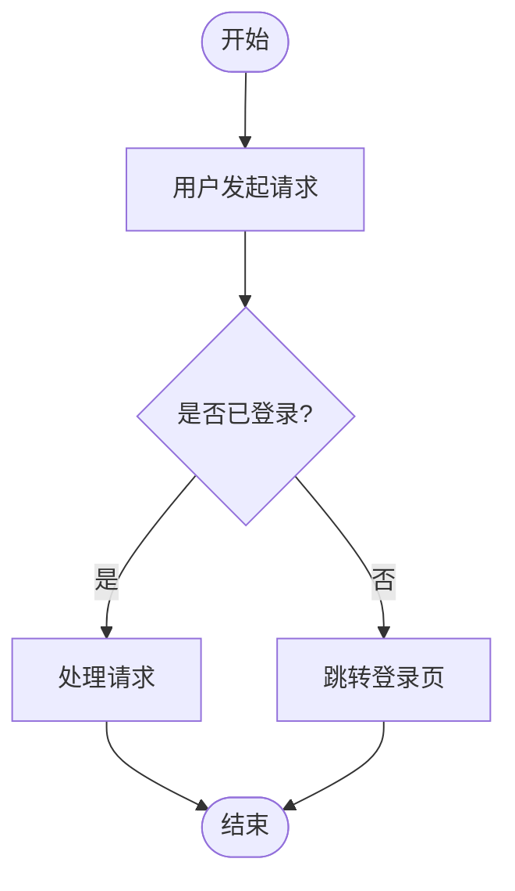

你是一个资深的软件设计师。请根据以下需求分析结果和系统设计，生成Mermaid格式的活动图。

## 需求分析结果

```json
{requirement_json}
```

## 系统设计说明

{design_text}

## 输出要求

只输出Mermaid flowchart代码，不要输出其他任何内容。

格式要求：
1. 第一行必须是 `flowchart TD` 或 `flowchart LR`
2. 使用标准的Mermaid flowchart语法
3. 节点文本使用中文
4. 覆盖主要业务流程（正常流程）
5. 包含异常流程分支（如有）
6. 使用菱形节点表示判断
7. 使用圆角矩形表示操作步骤
8. **必须**使用 `([开始])` 和 `([结束])` 标记流程的起止节点
9. 每个独立子流程都应有明确的开始和结束节点

示例格式：

