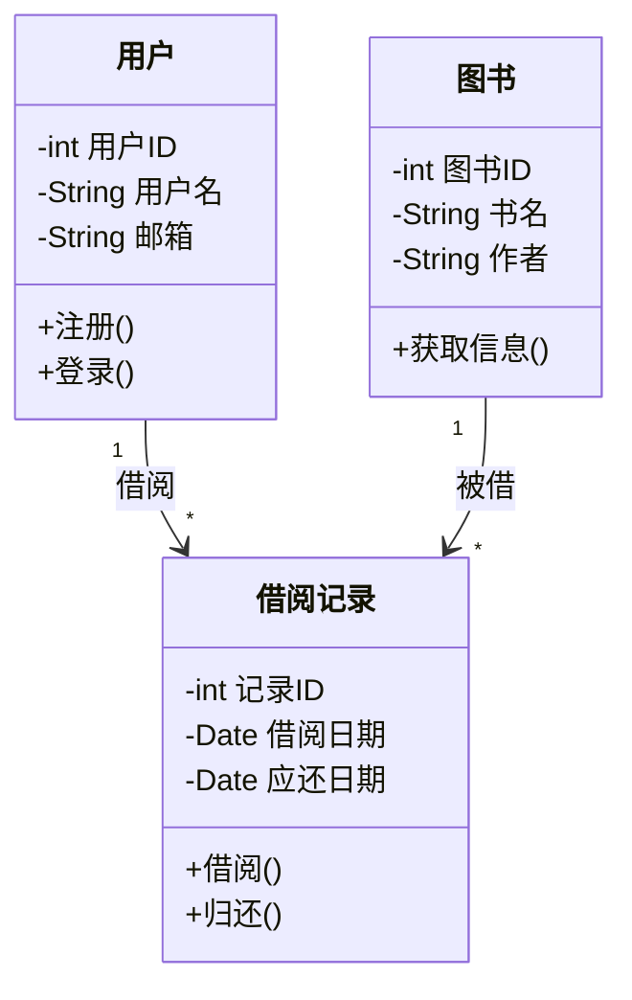

你是一个资深的软件设计师。请根据以下需求分析结果和系统设计，生成Mermaid格式的类图。

## 需求分析结果

```json
{requirement_json}
```

## 系统设计说明

{design_text}

## 输出要求

只输出Mermaid classDiagram代码，不要输出其他任何内容。

格式要求：
1. 第一行必须是 `classDiagram`
2. 使用标准的Mermaid classDiagram语法
3. **类名使用中文**，与需求分析中的实体名称保持一致（如：用户、图书、订单、会议室等）
4. 包含类之间的关系（继承、组合、依赖、关联）
5. 每个类包含关键属性和方法
6. 覆盖需求中识别出的所有核心实体
7. 方法名可以使用英文或中文

示例格式：

