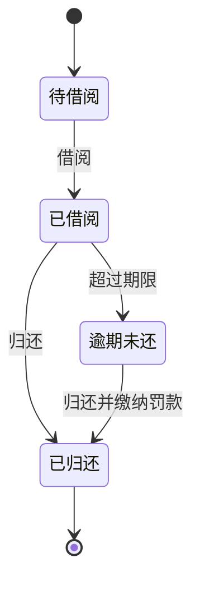

你是一个资深的软件设计师。请根据以下需求分析结果和系统设计，生成Mermaid格式的状态机图。

## 需求分析结果

```json
{requirement_json}
```

## 系统设计说明

{design_text}

## 输出要求

只输出Mermaid stateDiagram-v2代码，不要输出其他任何内容。

格式要求：
1. 第一行必须是 `stateDiagram-v2`
2. 使用标准的Mermaid stateDiagram-v2语法
3. 状态名使用中文或英文均可，但要保持一致
4. 覆盖核心实体的主要状态变化
5. 包含状态转换的触发条件
6. 标明初始状态和终止状态

示例格式：


注意：
1. **必须**覆盖2-3个最重要的核心实体的状态变化，用注释分隔不同实体的状态
2. 状态转换条件要从业务需求中提取，不要过度推测
3. 每个实体的状态应包含：初始状态、中间状态、终止状态
4. 使用 `note right of` 为不同实体添加说明
